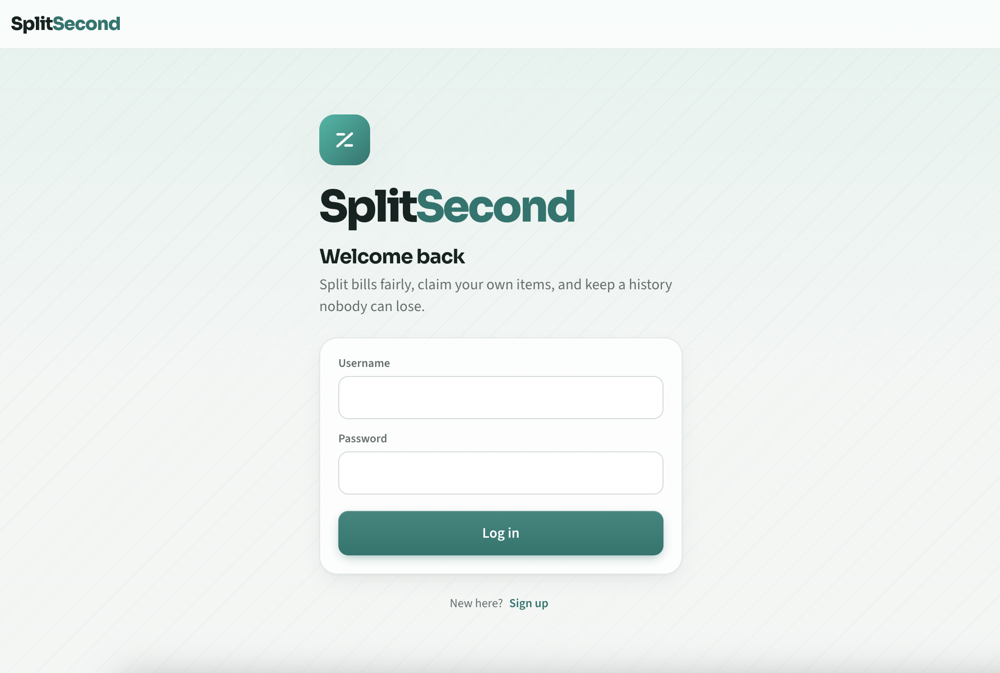
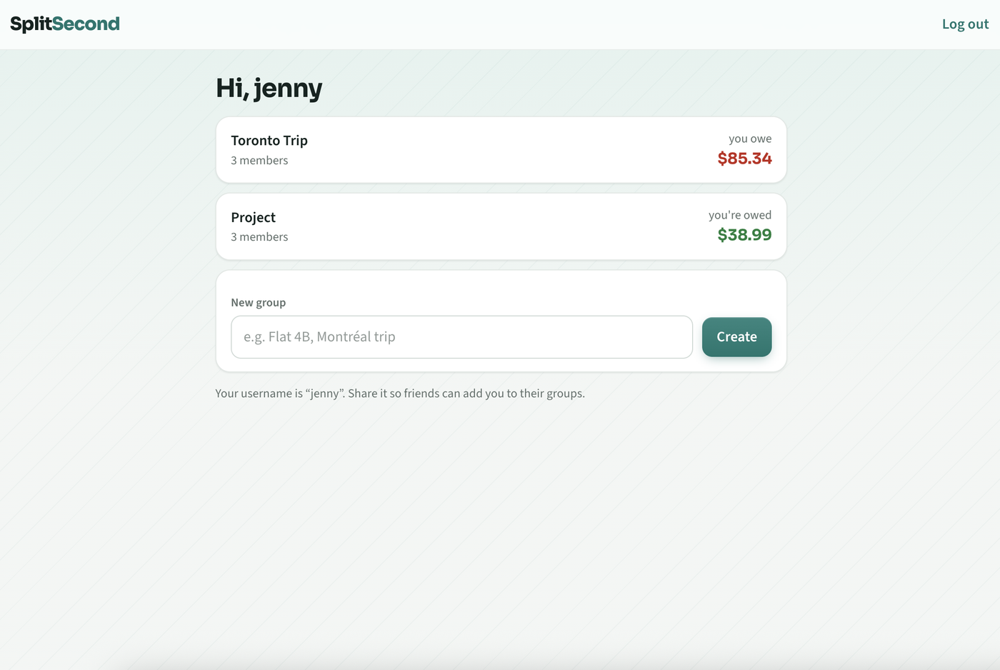
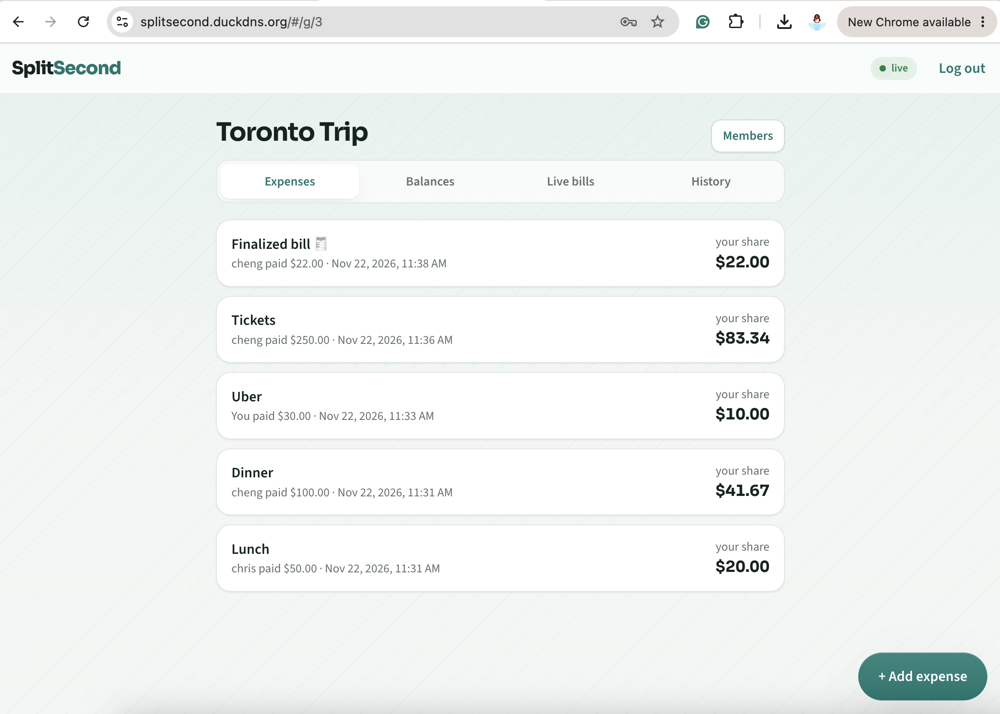
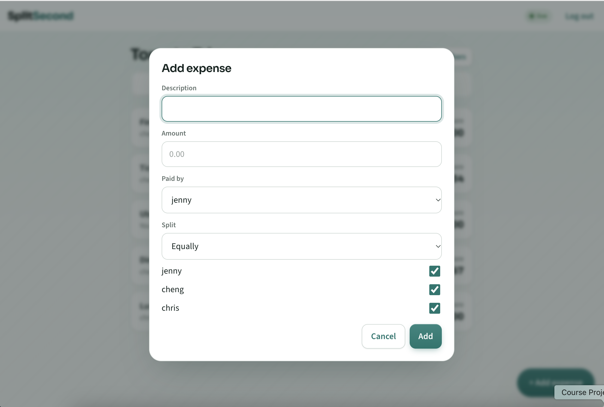
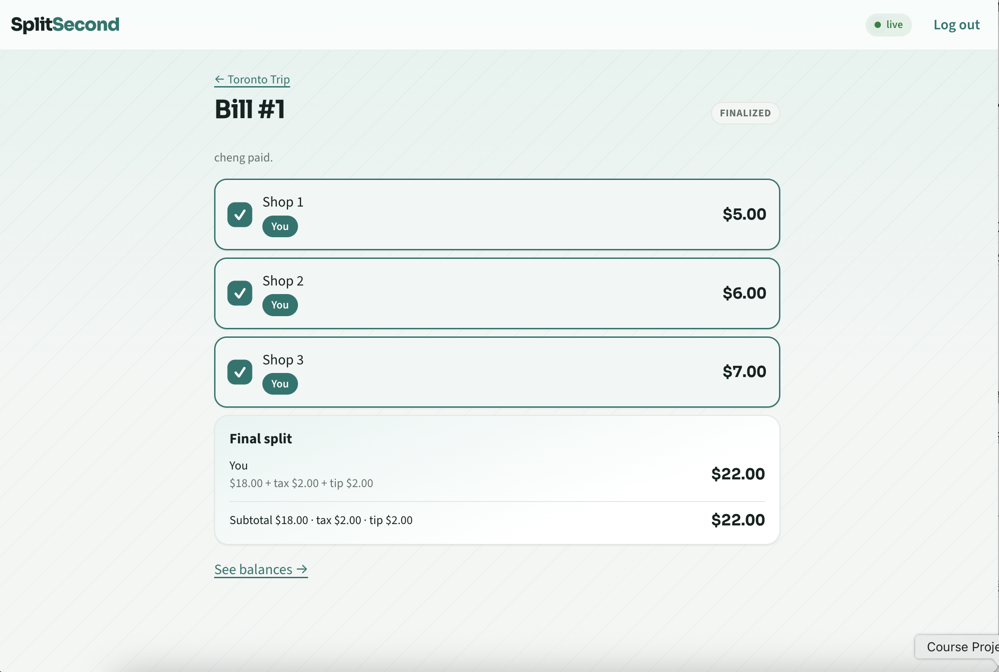
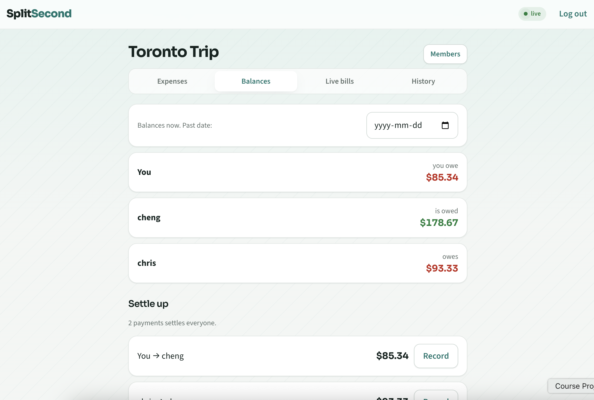
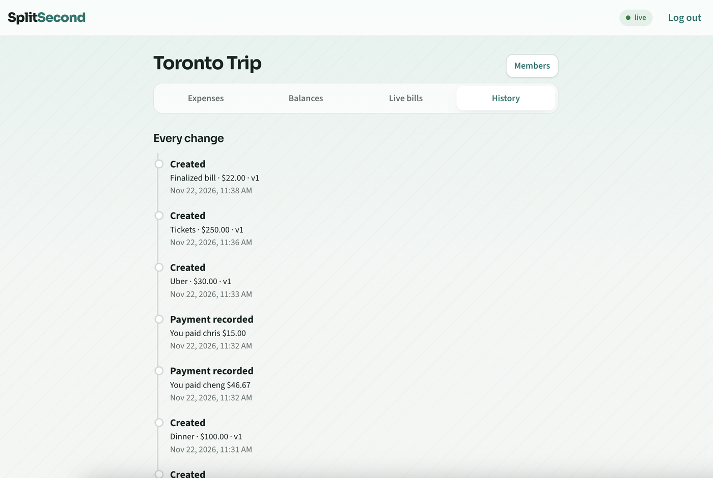
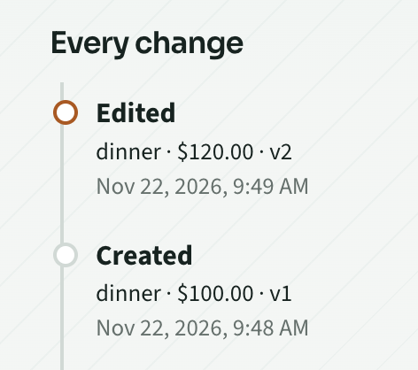

# SplitSecond

ECE1779 Cloud Computing, Fall 2026. Final project report.

## Team Information

| Name | Student number | Email |
| --- | --- | --- |
| Jenny Qin | 1006960068 | yide.qin@mail.utoronto.ca |
| Cheng Zhao | 1012816954 | chan.zhao@mail.utoronto.ca |
| Fuchun Chai | 1003052082 | fuchun.chai@mail.utoronto.ca |

## Motivation

Students often split rent, groceries, trips and dinners, and two problems come up repeatedly.

First, equal splits are often unfair. If one person orders a $14 noodle bowl and another orders a $38 steak and two drinks, an even split is quick but not fair. Splitting by what each person ordered means working out items, tax and tip by hand.

Second, shared records are easy to break. Groups keep track of debts in chats or spreadsheets, where entries get overwritten or deleted and nobody remembers why a balance changed. Splitwise helps, but for itemized splits one person still has to assign every item, and a wrong edit is hard to undo.

SplitSecond is a shared expense ledger for roommates, travel groups and friends. It adds live bill claiming, where the payer enters the receipt once and everyone claims their own items from their own phone at the same time, and a full history, where every change is kept so users can see balances as of a past date and restore an expense that was edited or deleted by mistake.

A ledger must not lose or corrupt data, so persistent storage and backups are central to the project rather than add-ons.

## Objectives

- Build an expense ledger that is exact (integer cents), whose balances cannot drift, and where concurrent edits cannot silently overwrite each other.
- Support real-time bill claiming even when a user's WebSocket and their requests reach different API replicas.
- Deploy on DigitalOcean Kubernetes with a replicated stateless API and a PostgreSQL StatefulSet on a persistent volume, served over HTTPS.
- Protect against data loss with continuous WAL archiving, daily base backups and dumps, and restore drills that measure the actual recovery point and recovery time.
- Run automated checks in CI on every push and pull request.

## Technical Stack

- Backend: Python, FastAPI, Uvicorn, psycopg 3 with psycopg-pool.
- Authentication: bcrypt password hashes and JWT (HS256, 7-day expiry).
- Frontend: a mobile-friendly static page (HTML, CSS, JavaScript) served by FastAPI.
- Database: PostgreSQL 16.
- Real time: WebSockets with PostgreSQL LISTEN/NOTIFY, no Redis.
- Containers: Docker and Docker Compose. Compose runs two API replicas, PostgreSQL, nginx and SeaweedFS (a local S3 stand-in).
- Orchestration: Kubernetes, using minikube locally and DigitalOcean Kubernetes (DOKS) in the cloud, with Kustomize base and overlays. We chose Kubernetes over Docker Swarm mainly for StatefulSets and CronJobs.
- Routing and TLS: Kubernetes Gateway API (Cilium GatewayClass on DOKS, Envoy Gateway on minikube) and cert-manager with Let's Encrypt.
- Persistent storage: a 5 GiB PersistentVolumeClaim (ReadWriteOnce) backed by a DigitalOcean Volume.
- Backups: wal-g (WAL archive and base backups) and a pg_dump CronJob, stored in DigitalOcean Spaces.
- Monitoring: DigitalOcean alerts and Uptime checks, plus `/health` and `/health/backup` endpoints.
- CI: GitHub Actions.

### Architecture

Clients connect over HTTPS and WSS to the Gateway, which routes to the `api` Service. The Service has two FastAPI pods. Both pods talk to a single PostgreSQL pod (StatefulSet `postgres-0`, with a base-backup sidecar) whose data directory is on the PVC. PostgreSQL archives WAL, base backups and dumps to DigitalOcean Spaces, which is outside the cluster.

The API is stateless, so any replica can serve any request and no sticky sessions are needed. The second replica is there for availability during rolling updates (`maxUnavailable: 0`) and not for load.

The database is a single instance on purpose. DigitalOcean Volumes are ReadWriteOnce, so if the node fails the volume has to be reattached elsewhere and the app is down for a few minutes. A replicated PostgreSQL setup would avoid that but needs failover logic we did not have time to test. For an expense app, short downtime is acceptable and data loss is not, so we put the effort into backups and tested restores. For the same reason we did not implement CPU auto-scaling: our traffic would not reach a CPU threshold, and scaling the API does not help the single database.

## Features

### Main features

- Accounts and groups. Users sign up, log in, create groups and add existing users. Every query is filtered by group membership, and non-members get a 404.
- Three split modes: equal, exact amounts and shares. Money is stored as integer cents. Leftover cents go one each to members in user ID order, so $100 split three ways is always 3334, 3333 and 3333 cents. A transaction is rejected if the shares do not add up to the total.
- Live bills. The payer enters receipt items, tax and tip. Members claim items in real time, shared items are split among the claimants, and tax and tip are divided in proportion to each person's subtotal (largest-remainder method). Finalizing turns the claims into a normal expense in one transaction.
- Balances and settle-up. Balances are computed from the ledger, and the settle-up plan needs at most n − 1 payments for n people. Payments can be recorded.
- History. Every create, edit, delete, restore and payment is listed. Balances can be queried as of a past date, and deleted expenses can be restored.

### Correctness

- The ledger is append-only. Each row belongs to a logical expense (`expense_id`) and has a `version`. An edit voids the current row and inserts version + 1, a delete voids it, and a restore inserts a copy. Balances are calculated from non-voided rows, and past balances are a query on `created_at` and `voided_at`.
- Edits use optimistic concurrency. The client sends the version it loaded, and the backend locks the active row with `SELECT ... FOR UPDATE` and compares it. A stale edit gets HTTP 409. A test with two simultaneous writers checks that one succeeds, one conflicts and two versions are stored.
- New expenses and settlements carry a client-generated idempotency key with a UNIQUE constraint, so a retry or double tap returns the original. A test sends 8 parallel requests with the same key.
- Claims lock the bill with `FOR SHARE` and finalize locks it with `FOR UPDATE`. A claim either lands before finalize and is counted, or waits and gets a 409. `UNIQUE(item_id, user_id)` makes claiming idempotent.
- The preview shown while claiming uses the same code as finalize, and a test checks that the two agree.

### How the features meet the course requirements

- Docker and Docker Compose: one API image and one PostgreSQL image (with wal-g). Compose runs the full stack locally with two API replicas.
- PostgreSQL: ten tables (`users`, `groups`, `group_members`, `expenses`, `expense_shares`, `bills`, `bill_items`, `item_claims`, `settlements`, `backup_runs`). Constraints, transactions and row locks enforce correctness. We run our own PostgreSQL and do not use a managed database.
- Persistent storage: a StatefulSet with a PVC on a DigitalOcean Volume, so data survives pod restarts and rescheduling.
- Deployment: DigitalOcean (DOKS, Container Registry, Volumes, Spaces).
- Orchestration: Kubernetes Deployment and Service for the API, StatefulSet and PVC for the database, a CronJob for dumps, and a Gateway with HTTPRoutes.
- Monitoring: described below.

### Advanced features

We implemented the following.

1. Real-time functionality. Live bills use WebSockets. A browser stays connected to one replica, but its claims may be handled by another. Each replica keeps one dedicated connection that runs LISTEN, and changes call `pg_notify` inside the same transaction, so events are sent only after commit and clients never see a rolled-back claim. Payloads contain only IDs (PostgreSQL limits payloads to 8000 bytes) and clients re-fetch over HTTP. Missed notifications are not stored, so clients reload the bill on reconnect. The server sends a ping every 30 seconds so proxies do not drop idle sockets, and we confirmed a connection stayed open for 150 seconds through the Gateway.
2. Backup and recovery. A nightly dump alone could lose a day of expenses, so we set a target of about five minutes of loss. PostgreSQL archives WAL with `archive_command = 'timeout 120 wal-g wal-push %p'` and `archive_timeout = 300`. A sidecar in the database pod takes a daily base backup with wal-g and keeps the last 7, which allows point-in-time recovery. A pg_dump CronJob (03:00 America/Toronto) writes a daily dump to Spaces that can be restored without wal-g.
3. Security. Passwords are hashed with bcrypt, sessions use JWT, every route checks group membership, the Gateway serves HTTPS with Let's Encrypt certificates (HTTP redirects to HTTPS), secrets are in Kubernetes Secrets, and API pods run as non-root.
4. CI. GitHub Actions runs on every pull request and push to main. `ledger-tests` runs the test suite against a PostgreSQL 16 service, `compose-smoke` starts the Compose stack and checks that both replicas answer `/health` through nginx, and `manifests` renders every Kustomize overlay and validates it with kubeconform. Deployment itself is a manual `kubectl apply`.

### Monitoring

- DigitalOcean alerts on node CPU, memory and disk usage.
- DigitalOcean Uptime checks on `/health` and `/health/backup`.
- `/livez` is the liveness probe and does not touch the database. `/health` is the readiness probe and checks the database. `/health/backup` returns 503 if the last dump or base backup is more than 26 hours old, if WAL archiving is failing, or if completed WAL segments have waited more than 15 minutes.
- The lag check exists because a failure alone is not enough: an idle database archives nothing, so the age of the last archive would cause false alarms. We tested it by stopping the local S3 service. The lag was reported after 75 seconds, the failure after 135 seconds, and the endpoint recovered about 30 seconds after storage came back.
- Each dump and base backup is recorded in the `backup_runs` table.

### Restore drills

We ran these on minikube on 2026-11-16.

- Dump restore: the `pg-dump` job followed by `restore-dump.sh latest restore_check`. It restored in under 1 second and 2 of 2 groups matched the snapshot.
- Point in time: take a snapshot at time T, void every expense, then run `restore-check.sh T`. The copy was restored and promoted in 4 seconds and balances matched the snapshot.
- Undo in production: `recover-postgres.sh T` brought the voided expenses back and balances matched.
- Sudden loss: a writer committed an expense every 2 seconds, we froze all PostgreSQL processes, and then recovered. The last 107 seconds of writes were lost (53 of 190 expenses), restored balances matched, and writes resumed 66 seconds after the crash. So RPO was 107 seconds and RTO was 66 seconds. Of the 66 seconds, 60 were the pod's termination grace period while the frozen processes ignored shutdown.

The drills found two bugs in our restore script. `recovery_target_time` does not accept the ISO `T...Z` form, so the script now converts it. A base backup taken after a restore kept the old recovery target in `postgresql.auto.conf`, so a later restore stopped too early. The script now removes earlier recovery settings.

## User Guide

The app is a mobile web page, so nothing needs to be installed. Open the live URL on a phone or in a browser.

1. Sign up or log in. A new user taps "Sign up" on the login page and picks a username and a password of at least 8 characters.

   

2. The home page lists your groups and how much you owe or are owed in each. To create a group, type a name and tap Create. Friends can be added from the Members button inside a group, by username (they must have signed up first).

   

3. Inside a group, the Expenses tab lists every expense with who paid and your share. Tap "+ Add expense" to add one.

   

4. In the Add expense form, enter a description and amount, choose who paid, choose the split (equally, exact amounts or shares) and select who takes part. The app rejects splits that do not add up to the total.

   

5. To split a restaurant bill, open the Live bills tab and create a bill with each item and price, plus tax and tip. Everyone opens the bill on their own phone and taps the items they had. If several people tap the same item it is split between them, and each person's total updates live. A member can also claim for someone without a phone. When every item is claimed, tap Finalize. If some items are unclaimed, the app lists them. The screenshot shows a finalized bill: three items of $5, $6 and $7 plus $2.00 tax and $2.00 tip give $22.00.

   

6. The Balances tab shows who owes whom and the smallest set of payments that settles the group. Tap Record when someone pays outside the app. The date field at the top shows balances as of a past day.

   

7. The History tab lists every change, including payments and finalized bills. Nothing is overwritten. In the second screenshot, a dinner was created at $100.00 (v1) and edited to $120.00 (v2), and the first version is still there. If two people edit the same expense at the same time, the second one gets a conflict warning and has to reload. A deleted expense can be restored from the history.

   

   

## Development Guide

More detail is in [docs/infra.md](docs/infra.md) for infrastructure and backups and [docs/api.md](docs/api.md) for the API and real-time protocol.

Prerequisites: Docker with Compose, Python 3.13 (the API image uses `python:3.13-slim`) and the PostgreSQL client tools if running without Docker. For Kubernetes you also need minikube, kubectl and helm, and doctl for DigitalOcean.

Run locally with Docker Compose:

```sh
cp .env.example .env            # change the passwords and JWT_SECRET
docker compose up -d --build --wait
curl localhost:8080/health      # "host" alternates between the two replicas
```

The app is at http://localhost:8080. Open it in two browsers to try live claiming. PostgreSQL is also published on `127.0.0.1:5433`, and SeaweedFS (local S3) on `127.0.0.1:9100`.

Configuration is through environment variables listed in `.env.example`: `POSTGRES_DB`, `POSTGRES_USER`, `POSTGRES_PASSWORD`, `JWT_SECRET`, `S3_ACCESS_KEY`, `S3_SECRET_KEY` and the host ports. On Kubernetes these come from Secrets created by `k8s/create-secrets.sh`, which generates random passwords and keeps existing Secrets.

Database: the schema is `backend/schema.sql`. It is applied only when the data volume is empty, so after a schema change run `docker compose down -v && docker compose up -d --build --wait`. There is no migration tool. For an existing cluster, apply the SQL by hand or reset the volume (see `docs/infra.md`).

Storage: Compose uses the named volume `pgdata`. Kubernetes uses a 5 GiB PVC named `data-postgres-0`, which is a DigitalOcean Volume on DOKS. Backups go to SeaweedFS locally and to DigitalOcean Spaces in the cloud.

Tests:

```sh
docker compose --profile test run --rm test
# or without Docker
createdb splitsecond_test_db
psql -X -v ON_ERROR_STOP=1 -d splitsecond_test_db -f backend/schema.sql
python -m unittest discover -s backend/tests -v
```

There are 55 test cases that run against PostgreSQL. They cover splitting and rounding, versioning, delete and restore, settlements, bill finalization, the API, and three concurrency races (versioning, settlement and finalize). `tools/e2e_two_replicas.py` checks that an event from one replica reaches a WebSocket on the other.

Kubernetes on minikube:

```sh
minikube start --driver=docker --cpus=2 --memory=4096
./k8s/minikube-setup.sh         # Envoy Gateway, cert-manager, local CA, Secrets
minikube image build -t splitsecond-api:dev .
minikube image build -t splitsecond-postgres:dev -f docker/postgres/Dockerfile .
kubectl apply -k k8s/overlays/minikube
```

Deploying to DigitalOcean: create a Container Registry, a private Spaces bucket and a one-node DOKS cluster, then run:

```sh
export LETSENCRYPT_EMAIL=... S3_ENDPOINT=https://tor1.digitaloceanspaces.com S3_REGION=tor1 \
       S3_ACCESS_KEY=... S3_SECRET_KEY=... S3_BUCKET=splitsecond-backups
./k8s/doks-setup.sh
docker buildx build --platform linux/amd64 --provenance=false --sbom=false -t "$REGISTRY:api" --push .
docker buildx build --platform linux/amd64 --provenance=false --sbom=false -t "$REGISTRY:postgres" -f docker/postgres/Dockerfile --push .
kubectl apply -k k8s/overlays/doks
```

After the first apply, point the DuckDNS hostname at the Gateway's load balancer IP. `docs/infra.md` covers the details, including building amd64 images and `imagePullPolicy: Always`.

Repository layout:

- `backend/app/`: FastAPI app (routes, auth, database pool, realtime, static web UI)
- `backend/ledger/`: split, balances, versioning, settle-up and finalize logic
- `backend/tests/`: database-backed unit, API and concurrency tests
- `backend/schema.sql`: PostgreSQL schema
- `backup/`: wal-g base backup, dump, PITR restore, drill and verification scripts
- `docker/`, `nginx/`: PostgreSQL image with wal-g, init scripts, nginx config
- `k8s/`: Kustomize base and overlays (minikube, doks), cluster issuers, setup scripts
- `docs/`: infrastructure and API docs, screenshots
- `.github/workflows/`: CI

Credentials: Credentials sent to TA. (TODO: confirm. If nothing was sent, replace this with "No private credentials are needed; secrets are generated locally from `.env.example`.")

## Deployment Information

Live application: https://splitsecond.duckdns.org

The app runs on a one-node DOKS cluster (4 GiB, 2 vCPU) with a managed load balancer. Images are in DigitalOcean Container Registry, the database volume is a DigitalOcean Volume, and backups are in a private Spaces bucket.

## AI Assistance & Verification (Summary)

See [ai-session.md](ai-session.md) for the full records.

We used AI to brainstorm project topics and features, to question our design, and to explain or draft parts of the infrastructure. We worked out the problem and a first design ourselves before asking AI for design help.

One example of a limitation: an early AI-drafted plan listed CPU-based auto-scaling as a main advanced feature. We questioned it because our traffic is a few requests per minute and would never reach a CPU threshold, so showing it would need fake load, and scaling the stateless API does not protect the single database. We replaced it with backup and recovery.

We checked correctness in three ways. The database-backed tests, including the concurrency tests, run in CI on every push. Claims about PostgreSQL were checked against its documentation: the AI said NOTIFY is delivered only after commit, and the documentation confirmed that and also said sessions that are not listening at that moment never receive the message, which is why clients reload the bill on reconnect. Backups were verified with the restore drills above, comparing restored balances to snapshots computed with the ledger's own functions.

## Individual Contributions

(TODO: check against `git log` before submitting.)

Cheng Zhao: the ledger and data layer. This covers the PostgreSQL schema, integer-cent split and rounding logic for equal, exact and shares modes, append-only versioning with optimistic concurrency, soft delete and restore, historical balances, settle-up, settlement recording, bill finalization, and the ledger and concurrency tests.

Jenny Qin: the application layer. This covers the FastAPI API, authentication (bcrypt and JWT) and group permissions, the mobile web UI, WebSockets with LISTEN/NOTIFY, the live-bill claiming API, the API tests and the two-replica end-to-end check.

Fuchun Chai: infrastructure. This covers the Dockerfiles, Compose, the Kubernetes manifests, Gateway API and HTTPS, the DOKS deployment, persistent storage, wal-g backups and point-in-time recovery, the restore drills, health and backup monitoring, and the CI workflow.

Pull requests were reviewed by someone from another area.

## Lessons Learned and Concluding Remarks

- For a ledger, short downtime is acceptable and lost data is not. Dropping auto-scaling and spending the time on recovery was the right call for this project.
- Backups need to be restored to be trusted. The drills found two bugs in our restore script and gave us measured numbers (107 s RPO, 66 s RTO).
- Having PostgreSQL enforce correctness through constraints, row locks and one transaction per request gave us idempotency and no lost updates with less code than application-level locking.
- LISTEN/NOTIFY was enough for our realtime needs and let us avoid Redis, but we had to work around its limits: small payloads and no replay.
- Several cloud details cost us time. DOKS manages the Gateway API CRDs, so Envoy Gateway could not be installed there. Images built on a Mac are arm64 while the nodes are amd64. wal-g can retry for many minutes without failing unless a timeout is set.

Known limitations: the database is a single point of failure, edits support only equal splits and cannot change the payer, the history does not show who made a change, and there is no multi-currency support or native app.

## Video Demo

Video URL: TODO (2 to 5 minutes, in the team's own voice, with access given to the instructor and TAs `cying17`, `Gabeinstein` and `YirenZzz`).
